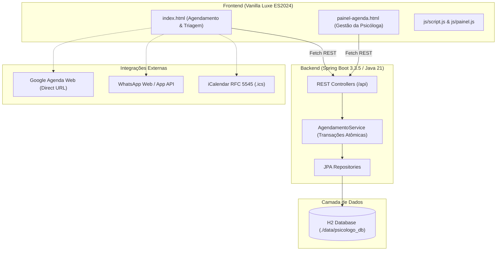

<div align="center">

# 🌿 Thalita de Paula | Plataforma Clínica & Sistema de Agendamento v3

**Solução Full-Stack Completa: Landing Page Dark Luxe, Backend Spring Boot 3 com Java 21, Banco de Dados H2 Persistente, Sincronização Google Agenda e Painel Administrativo**

[]()
[](https://openjdk.org/projects/jdk/21/)
[](https://spring.io/projects/spring-boot)
[](https://www.h2database.com/)
[](https://developer.mozilla.org/pt-BR/docs/Web/HTML)
[](https://developer.mozilla.org/pt-BR/docs/Web/CSS)
[](https://developer.mozilla.org/pt-BR/docs/Web/JavaScript)
[](https://calendar.google.com/)
[]()

<br />

</div>

---

## 📌 Sobre a Versão 3.0 (v3-enterprise)

A **Versão 3.0** transforma a experiência clínica em uma **arquitetura Full-Stack de nível empresarial**, unindo a sofisticação do design Dark Luxe a um **motor de backend robusto em Java 21 com Spring Boot 3 e banco de dados relacional H2**.

### 🌟 Destaques da Evolução (v2 ➔ v3)
1. **Banco de Dados Relacional H2 Persistente**: Armazenamento durável em arquivo local com grade de **612 slots pré-configurados** (Segunda a Sábado, das 08:30 às 20:30, sábados encerrando às 17:30 e domingos fechados).
2. **Controle Atômico de Concorrência**: Bloqueio atômico de horários. Quando um paciente agenda, o horário fica indisponível em tempo real no banco. Se cancelado no painel, o slot é liberado automaticamente.
3. **Sincronização Direta com Google Agenda**: Botão dedicado de 1 clique que abre o Google Calendar Web no navegador com data, horário de 50 minutos, protocolo e endereço pré-preenchidos — sem necessidade de downloads de arquivos.
4. **Alarme Duplo Universal (.ics)**: Arquivo iCalendar padrão RFC 5545 com dois alarmes programados (48 horas e 2 horas antes da sessão) para Apple Calendar e Outlook.
5. **Inicializador 1-Clique Portável (`iniciar.bat`)**: Script de orquestração com verificação automática de portas, compilação via Maven Wrapper (`mvnw`), inicialização em segundo plano e abertura instantânea do navegador.
6. **Resiliência com Fallback Offline**: Caso o servidor backend seja interrompido, o frontend faz fallback transparente e instantâneo para o `localStorage`, sem quebrar a jornada do paciente.

---

## ⚡ Principais Funcionalidades

### 1. 📅 Motor de Agendamento Inteligente (`#agendamento`)
- **Grade Real de Horários**: Consulta em tempo real à API REST `/api/disponibilidade/dia` para desabilitar visualmente chips de horários já reservados (`.time-chip.disabled`).
- **Resumo Dinâmico em Tempo Real**: Feedback visual imediato com data formatada, horário, modalidade (Presencial na Vila Ema ou Online e-Psi) e foco clínico.
- **Modal de Confirmação Multicanal**:
  - 🟢 **WhatsApp com Protocolo**: Envia mensagem estruturada com código exclusivo (`#PSI-XXXX`).
  - 🔵 **Salvar no Google Agenda (Abre Direto)**: Abre o Google Calendar com todos os detalhes prontos para salvar com 1 clique.
  - 🍏 **Salvar no iPhone / Outlook (.ics)**: Download do arquivo `.ics` com feedback visual imediato e guia de uso.

### 2. 🗂️ Painel Administrativo da Psicóloga (`painel-agenda.html`)
- **Badge de Status de Conexão**: Indicador visual dinâmico `🟢 Spring Boot Ativo (H2 DB)` ou `🟡 Modo Local (Offline)`.
- **Detector Automático da Janela de 48h**: Destaca em dourado os atendimentos que exigem confirmação ética de presença.
- **Disparo de Confirmação via WhatsApp**: Envia template pré-formatado diretamente para o paciente com um clique.
- **Gestão de Ciclo de Vida**: Transições de status (*PENDENTE_48H*, *CONFIRMADO*, *CONCLUIDO*, *CANCELADO*) com sincronização automática do banco H2.
- **Exportação de Relatórios**: Download de relatório completo em CSV compatível com Excel e Google Sheets.

---

## 🏗️ Arquitetura do Sistema



---

## 🔌 Endpoints da API RESTful

| Método | Endpoint | Descrição |
|---|---|---|
| `GET` | `/api/agendamentos/health` | Health check da API (`UP`) |
| `GET` | `/api/disponibilidade/dia?data=YYYY-MM-DD` | Lista status de todos os 12 slots da data |
| `GET` | `/api/disponibilidade/mes?ano=YYYY&mes=MM` | Grade mensal de ocupação |
| `GET` | `/api/agendamentos` | Lista todos os agendamentos cadastrados |
| `POST` | `/api/agendamentos` | Cria novo agendamento com trava atômica (Retorna 409 em caso de conflito) |
| `PATCH` | `/api/agendamentos/{id}/status` | Atualiza status e libera o slot se cancelado |
| `POST` | `/api/agendamentos/{id}/disparar-lembrete` | Registra disparo de confirmação 48h |
| `GET` | `/api/agendamentos/estatisticas` | Retorna KPIs em tempo real para o painel |

---

## 💻 Como Executar o Projeto

### Pré-requisitos
* **Java 21 LTS** ou superior instalado na máquina ([Download OpenJDK 21](https://adoptium.net/temurin/releases/?version=21)).
* *(Opcional)* O Maven **não** precisa estar instalado; o projeto já inclui o **Maven Wrapper (`mvnw`)**.

### Opção 1: Inicializador 1-Clique (Recomendado no Windows)
Basta dar **dois cliques** no arquivo na raiz do projeto:
```text
iniciar.bat
```
ou
```text
INICIAR_PROJETO.bat
```
O script cuidará de tudo:
1. Verifica o Java 21;
2. Compila o backend via Maven Wrapper caso necessário;
3. Libera a porta 8080 caso esteja presa;
4. Inicia o servidor Spring Boot em segundo plano;
5. Aguarda o health check responder `UP`;
6. Abre automaticamente o site no seu navegador padrão (`http://localhost:8080`).

### Opção 2: Linha de Comando (Terminal)
```bash
# Entre na pasta do backend
cd backend

# No Windows:
.\mvnw.cmd spring-boot:run

# No Linux/macOS:
chmod +x mvnw
./mvnw spring-boot:run
```

Após iniciar, acesse:
* **Site Principal (Paciente)**: `http://localhost:8080`
* **Painel Administrativo da Psicóloga**: `http://localhost:8080/painel-agenda.html`
* **Console SQL do Banco H2**: `http://localhost:8080/h2-console`
  * **JDBC URL**: `jdbc:h2:file:./data/psicologo_db`
  * **User**: `sa`
  * **Password**: *(em branco)*

---

## 📁 Estrutura de Diretórios da v3

```text
Psicologo-Moderno/
├── backend/
│   ├── .mvn/wrapper/             # Configuração do Maven Wrapper portável
│   ├── src/
│   │   ├── main/
│   │   │   ├── java/com/psicologia/agenda/
│   │   │   │   ├── config/       # WebCorsConfig e DataInitializer (Seed 612 slots)
│   │   │   │   ├── controller/   # AgendamentoController e DisponibilidadeController
│   │   │   │   ├── dto/          # Java Records (Request / Response DTOs)
│   │   │   │   ├── exception/    # RFC 7807 ProblemDetail Exception Handlers
│   │   │   │   ├── model/        # Entidades JPA (Agendamento, Disponibilidade)
│   │   │   │   ├── repository/   # Spring Data JPA Repositories
│   │   │   │   └── service/      # Regras de Negócio e Travas Atômicas
│   │   │   └── resources/
│   │   │       └── application.yml # Configurações H2, Virtual Threads e Porta 8080
│   │   └── test/                 # Testes unitários e de integração
│   ├── mvnw                      # Maven Wrapper script Linux/macOS
│   ├── mvnw.cmd                  # Maven Wrapper script Windows
│   └── pom.xml                   # Configuração de dependências Spring Boot 3.3.5
├── css/
│   ├── style.css                 # Estilos da landing page, agendamento, Google Agenda e triagem
│   └── painel.css                # Estilos do painel de controle e badge de status do banco
├── js/
│   ├── script.js                 # Integração com API REST, Google Agenda Web e fallback local
│   └── painel.js                 # Lógica do painel, KPIs, disparo 48h e sincronização REST
├── img/                          # Identidade visual, fotos da clínica e favicons
├── index.html                    # Landing page pública com motor de agendamento integrado
├── painel-agenda.html            # Painel administrativo da profissional
├── privacidade.html              # Política de Privacidade & conformidade ética LGPD
├── iniciar.bat                   # Inicializador 1-clique Windows
├── INICIAR_PROJETO.bat           # Atalho de inicialização
├── iniciar.ps1                   # Script mestre PowerShell com health check e menu interativo
├── .gitignore                    # Regras estritas de exclusão (ignora target/ e data/)
├── LICENSE                       # Licença do projeto
└── README.md                     # Documentação completa da versão v3.0.0
```

---

## ⚖️ Conformidade Ética & LGPD

* **Resolução CFP nº 11/2018**: Adequação completa às normas de prestação de serviços psicológicos realizados por meios de tecnologias da informação e da comunicação.
* **LGPD (Lei nº 13.709/2018)**: Coleta estrita de dados necessários para contato clínico e prontuário, sem compartilhamento com terceiros não autorizados.

---

<div align="center">

**Desenvolvido com excelência técnica, rigor estético e conformidade clínica.**  
*Thalita de Paula · Psicóloga Clínica · CRP 00/[00000]*

</div>
