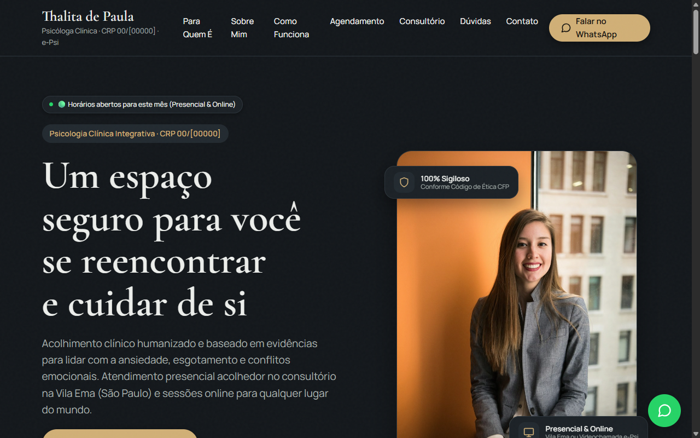
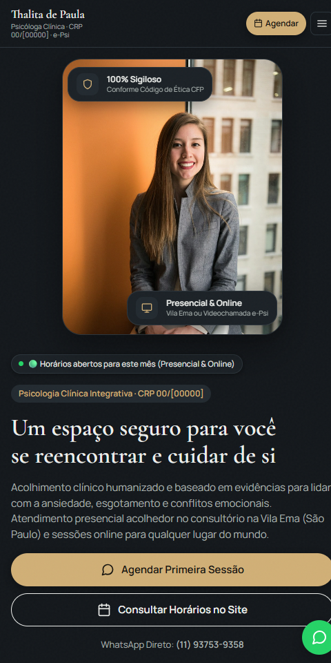
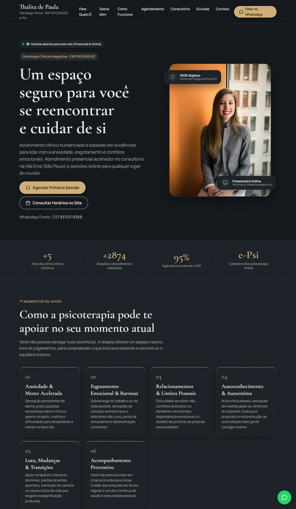

<div align="center">

# 🌿 Thalita de Paula | Psicologia Clínica & Psicoterapia

**Landing Page de Alta Conversão, Agendamento Inteligente e Presença Digital**

[](https://developer.mozilla.org/pt-BR/docs/Web/HTML)
[](https://developer.mozilla.org/pt-BR/docs/Web/CSS)
[](https://developer.mozilla.org/pt-BR/docs/Web/JavaScript)
[]()
[]()
[]()

<br />

</div>

---

## 📌 Sobre o Projeto

Plataforma digital moderna e de alta conversão desenvolvida para psicólogos clínicos, com foco em acolhimento ético, apresentação de especialidades e facilidade no agendamento de consultas tanto **Presenciais** quanto **Online**.

O projeto conta com arquitetura *Mobile-First*, tema exclusivo **Noturno Elegante** (*dark modern theme* `#13171B` com toques em ouro champagne `#D0AF76`), tipografia editorial de luxo (*Cormorant Garamond* e *Manrope*), microinterações táteis e total conformidade com as diretrizes do **CFP** e da **LGPD**.

Construído 100% em **HTML5, CSS3 e JavaScript puro (Vanilla)**, garantindo carregamento instantâneo, zero dependências pesadas e nota máxima em performance.

---

## 📸 Demonstração Visual

### 1. Seção Principal (Hero & Apresentação)
Design imersivo com tipografia clássica, proposta de valor humanizada, credenciais profissionais ativas (CRP e e-Psi), foto de destaque e botões de chamada rápida para ação.



---

### 2. Experiência Mobile & Responsividade
Layout homologado para telas de **320px a 440px** (iPhone SE, Galaxy, iPhone 16 Pro Max), sem transbordamento horizontal. O cabeçalho mobile conta com o nome da psicóloga formatado em duas linhas elegantes, botão de agendamento em destaque e menu gaveta com transição fluida.

<div align="center">
  
</div>

---

### 3. Visão Geral da Estrutura
Fluxo completo com seções organizadas estrategicamente: Métricas de Atendimento, Queixas Clínicas Acolhidas, Apresentação Profissional, Consultório Físico, Sistema de Agendamento e Dúvidas Frequentes (FAQ).



---

## ⚡ Principais Funcionalidades & Recursos

- **Agendamento Inteligente pelo Site:**
  - Seleção dinâmica entre atendimento Presencial ou Online.
  - Escolha de período de preferência (Manhã, Tarde ou Noite).
  - Máscara automática para número de WhatsApp no formato `(XX) XXXXX-XXXX`.
  - Geração de código de protocolo exclusivo (`#PSI-XXXX`).
  - Modal de confirmação que monta automaticamente a mensagem no WhatsApp.
- **Hub de Rotas & Mobilidade com 1 Clique:**
  - 🗺️ Rota traçada diretamente no **Google Maps**.
  - 🚗 Navegação em tempo real via **Waze**.
  - 🚕 Chamada direta de corrida pelo **Uber** com destino já preenchido.
  - 📇 Download de cartão de contato digital (**vCard / .vcf**) direto para a agenda do smartphone.
- **Balão Inteligente do WhatsApp:** Disparado suavemente após 5 segundos de navegação, com botão de fechar e memorização de sessão.
- **Banner de Privacidade & Cookies (LGPD):** Aviso de consentimento discreto com persistência via `localStorage`.
- **Perguntas Frequentes (FAQ):** Acordeão nativo HTML5 (`<details>` e `<summary>`) para esclarecimento rápido de dúvidas (convênios, sigilo e primeira sessão).
- **Rastreamento de Conversões:** Pré-configurado para envio de eventos de lead para **Google Analytics 4 (GA4)** e **Meta Pixel**.

---

## 🛠️ Tecnologias & Engenharia

| Tecnologia | Finalidade |
| :--- | :--- |
| **HTML5 Semântico** | Estruturação acessível com tags semânticas (`header`, `main`, `section`, `article`, `footer`, `details`, `summary`). |
| **CSS3 Moderno** | Design Tokens com CSS Custom Properties, layout flexível com CSS Grid/Flexbox, tipografia fluida e suporte a *safe area insets* (iOS notches). |
| **JavaScript Vanilla (ES6+)** | Lógica de agendamento, validação de formulário, máscara de telefone, rotas de mobilidade e controle de cookies sem frameworks ou bibliotecas pesadas. |
| **Vetores SVG Embutidos** | Ícones vetoriais leves e nítidos em qualquer resolução sem carregar fontes de ícones externas. |
| **Schema.org (JSON-LD)** | Dados estruturados para indexação no Google com informações de profissional de saúde e serviços clínicos. |

---

## 📁 Estrutura de Diretórios

```text
Psicologo/
├── css/
│   └── style.css                 # Estilização completa, variáveis do tema e responsividade
├── js/
│   └── script.js                 # Lógica de agendamento, rotas, máscara, modal e LGPD
├── img/
│   ├── screenshot-desktop.png    # Captura em alta resolução da versão Desktop
│   ├── screenshot-mobile.png     # Captura em alta resolução da versão Mobile
│   ├── screenshot-full.png       # Captura da visão completa da página
│   ├── psicologa-exemplo.jpg     # Foto da psicóloga
│   ├── consultorio-1.jpg         # Foto do consultório físico
│   └── favicon.svg               # Favicon minimalista em formato SVG
├── index.html                    # Landing page principal completa, semântica e responsiva
├── privacidade.html              # Página dedicada de Política de Privacidade e LGPD
├── .gitignore                    # Regras de exclusão do Git
└── README.md                     # Documentação do projeto
```

---

## 💻 Como Usar o Projeto

Por ser um projeto construído exclusivamente em **HTML5, CSS3 e JavaScript puro**, ele não requer Node.js, compilação ou banco de dados:

1. **Execução Direta:** Basta abrir o arquivo `index.html` em qualquer navegador web moderno (Google Chrome, Microsoft Edge, Safari, Firefox).
2. **Via Live Server:** Caso utilize o VS Code ou Cursor, clique com o botão direito no arquivo `index.html` e selecione **"Open with Live Server"**.

---

## 📄 Licença

Este projeto foi desenvolvido para apresentação profissional e comercial de landing pages clínicas de alta conversão. Livre para uso e customização.
